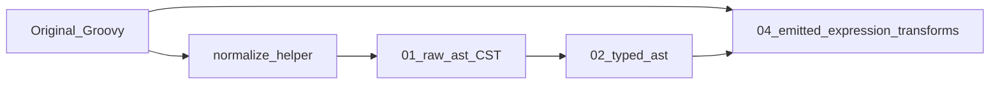

# Normalize step: evaluation and recommendation

## Verdict

Do **not** add a new pipeline stage (`00_normalize/` or renumbered intermediates). Keep normalization as a hidden pre-parse helper inside step 1 (same pattern as discovery).

## Current state

Normalize already exists but is not staged:

- `normalize_groovy_for_treesitter` in [src/tektonize/parser/groovy_ast.py](src/tektonize/parser/groovy_ast.py) rewrites only `[:]` to `__TEKTONIZE_EMPTY_MAP__`
- Applied in `get_raw_tree` / `parse_source`; converter aligns diagnostics to the normalized text
- Emit undoes the sentinel via ExpressionTransformer and TypeMapper
- Fallback parser uses original source (must keep `[:]`)
- Noise filter in [parse_diagnostics.py](src/tektonize/parser/parse_diagnostics.py) drops optional `;`, nested ERROR, leftover `:`, lone backslash
- Documented in [docs/01_raw_ast.md](docs/01_raw_ast.md) as part of step 1

`STAGE_ORDER` remains `01_raw_ast` through `05_final` only.

## Why a formal stage is low value

- Method bodies stay raw text; Elvis and safe-nav are rewritten at emit time. Their CST ERROR is usually soft noise, not a structural blocker (unlike empty map in parameter defaults).
- After current normalize+filter: empty map / ternary / GString / map literals are clean; Elvis / safe-nav / spread / spaceship / regex still show about one issue each and are already handled downstream.
- A staged normalize dir would dump near-identical Groovy files, force stage renumber / `--stages` / docs churn, and create two source truths while fallback must keep the original.

## When to expand the helper (not a stage)

Grow `normalize_groovy_for_treesitter` only when a construct both (1) floods soft diagnostics or breaks header extraction, and (2) has a safe rewrite (equivalent Groovy or a sentinel with one undo path).

Do **not** normalize Elvis/safe-nav first just because they ERROR — that duplicates ExpressionTransformer and risks wrong semantics (`?:` is falsy, not null-only).

Any new rewrite must add a regression test in [tests/test_regression_parse.py](tests/test_regression_parse.py).

## Recommended action

No stage implementation. Optional docs-only follow-up: state in docs that normalize is intentional non-staged, with the criteria above.
