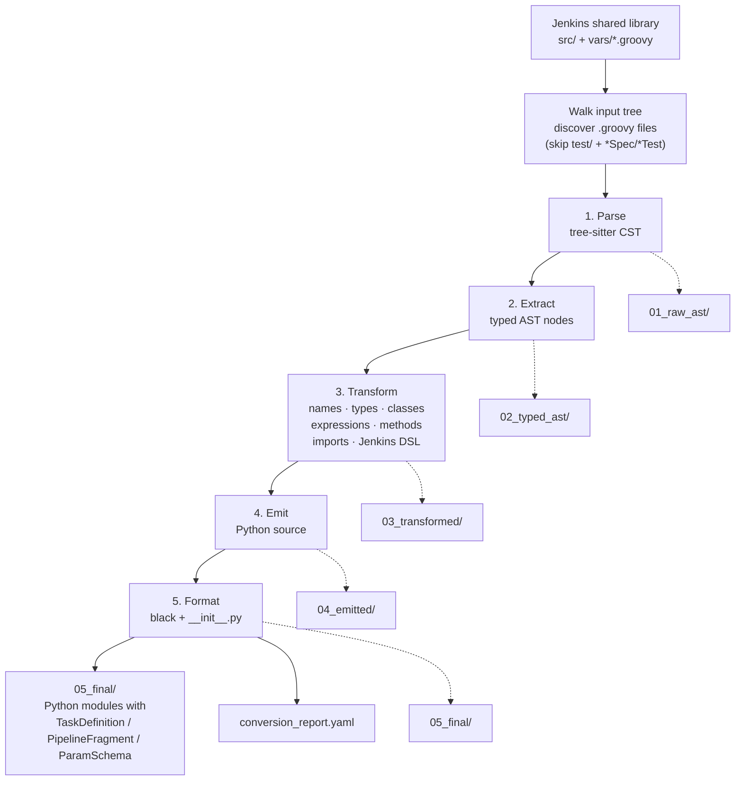

# tektonize

Convert Jenkins shared-library Groovy into Python that describes **incomplete**
Tekton Task definitions and composable pipeline fragments.

## TL;DR

Quick start if you only want to convert a library:

```bash
git clone <repo-url> tektonize
cd tektonize
make install && eval "$(make activate)"

tektonize convert --input-dir /path/to/your-jenkins-shared-library
```

Or with podman (build once, mount the library read-only, write results to `./output`):

```bash
git clone <repo-url> tektonize
cd tektonize
make image   # or: podman build -t tektonize:latest -f Containerfile .

mkdir -p output
podman run --rm \
  -v /path/to/your-jenkins-shared-library:/input:ro \
  -v "$(pwd)/output:/output:Z" \
  tektonize:latest convert \
    --input-dir /input \
    --output-dir /output
```

Results land in `./output/<UTC-timestamp>/` by default (local install), or in the
host directory you mount as `--output-dir` (podman example above writes into
`./output/`):

| Path | What you want |
|------|----------------|
| `05_final/` | Formatted Python + Tekton abstractions |
| `conversion_report.yaml` | Overall status, per-stage failure counts, TODO counts |
| `<stage>/conversion_report.yaml` | Failures for that stage (parse, emit, compile, …) |

Override the output location with `--output-dir`. `convert` / `convert-file` always
print the conversion report at the end. Pipeline design details live in
[docs/](docs/).

## What It Does

`tektonize` parses Groovy sources from a Jenkins shared library and produces:

- **Python modules** mirroring the original folder structure (`src/`, `vars/`)
- **Tekton Task definitions** — reusable, parameterized tasks (one per step method)
- **Pipeline fragments** — ordered task lists with `when` conditions for each scenario
- **Parameter schemas** — declared but unbound params that a job-invoker converter can fill in

The output is intentionally **incomplete** — it covers the shared-library half only.
A separate converter (or manual work) can compose these fragments into full Tekton
`PipelineRun` YAML by adding parameter values, triggers, and workspace bindings.

**Jenkins parameter values are never loaded or substituted.** Convert keeps
`params.FOO` / `env.BAR` as references, harvests UPPER_SNAKE `params.*` *names*
into an unbound `ParamSchema`, and leaves binding concrete values to a future
job-invoker (or manual PipelineRun work). Do not feed a Jenkins controller’s
global/job parameter map into `tektonize convert`.

## Scripted vs Declarative Pipelines

`tektonize` accepts any Jenkins shared-library Groovy tree; it does **not** reject
Declarative Pipelines. In practice it is **tuned for scripted-style shared libraries**.

**Works well (primary target):**

- `src/` classes and step factories
- Thin `vars/*.groovy` entry points with `def call(...)`
- Bodies using `script.sh()`, `script.stage()`, bare `sh` / `echo` / `stage`,
  `withCredentials`, and similar scripted DSL

**Limited today (Declarative Pipeline DSL):**

- Outer Declarative constructs such as `pipeline { }`, `agent { }`, `stages { }`,
  `when { }`, and `post { }` are **not specially modeled**
- Those blocks mostly pass through as ordinary Groovy and often become
  `# GROOVY:` comments or `# TEKTONIZE-TODO:` markers rather than structured
  `PipelineFragment`s
- If a Declarative job only wraps a thin `vars/` call and puts real logic in
  `src/` classes, the library side still converts reasonably; the Declarative
  shell itself converts poorly

| Style | Expectation |
|-------|-------------|
| Scripted shared lib (`src/` + `vars/`, `script.*` / builders) | Primary target — best fit today |
| Declarative `pipeline { }` in `vars/` | Can run, but Declarative DSL is largely unmapped |
| Declarative with logic inside `script { }` | Inner scripted bits may map; outer Declarative structure will not |

Improving Declarative support would mean adding explicit mappings for
`pipeline` / `agent` / `stages` / `when` / `post` (and related directives).

## Prerequisites

- Python 3.10+
- pip

Optional (container image):

- podman or docker

## Installation

Installations always use a local virtualenv (`.venv/`). The Makefile creates it
if missing and runs `pip` only inside that environment.

```bash
git clone <repo-url> tektonize
cd tektonize

# Create .venv (if needed), install the package, activate in this shell
make install && eval "$(make activate)"

# Or with dev dependencies (pytest, coverage, ruff, mypy)
make install-dev && eval "$(make activate)"
```

`make` cannot change your current shell’s environment by itself, so
`eval "$(make activate)"` (or `source .venv/bin/activate`) is required once
after install. If the venv is already active, `make install` says so and skips
the reminder.

Or call tools via the venv without activating:

```bash
.venv/bin/tektonize --help
.venv/bin/pytest -v tests/
```

Makefile shortcuts:

```bash
make install       # create .venv + pip install -e . + tektonize --help
make install-dev   # create .venv + pip install -e ".[dev]" + tektonize --help
make activate      # print source line — use: eval "$(make activate)"
make test          # run pytest inside .venv
make convert       # run tektonize from .venv (set INPUT_DIR=...)
make image         # build container image (IMAGE=tektonize:latest)
```

### Container image

```bash
# Build
podman build -t tektonize:latest -f Containerfile .
# or: make image

# Convert a library (mount host paths into /work)
podman run --rm \
  -v /path/to/my-jenkins-shared-library:/input:ro \
  -v "$(pwd)/output:/output:Z" \
  tektonize:latest convert \
    --input-dir /input \
    --output-dir /output
```

`ENTRYPOINT` is `tektonize`; pass any subcommand (`convert`, `convert-file`, `report`, `--help`).

## Usage

### Convert an entire shared library

```bash
tektonize convert \
    --input-dir /path/to/my-jenkins-shared-library
```

By default, outputs go to `./output/<UTC-timestamp>` (for example
`./output/20261016T112045Z`). Pass `--output-dir` to override, or
`--in-place` to write stage dirs (`01_raw_ast/` … `05_final/`) and reports
directly into `--input-dir` (overrides `--output-dir`).

Optional flags:

- `--dsl-hints PATH` — YAML/JSON map of `stepName -> TEKTONIZE-TODO` message
  text only (does not change matching). See
  [examples/dsl-hints.example.yaml](examples/dsl-hints.example.yaml).
- `--default-image IMAGE` — default container image for `TaskStep`
  (default: `ubuntu:22.04`).

Library-specific `with*` / `sh*` wrappers are matched **by shape** (any name),
not by a product allowlist. Exact names remain only for core Jenkins/plugin
steps. Details: [docs/03_transformed.md](docs/03_transformed.md).

While converting, the CLI prints each pipeline step with a short description and
how long it took (for example `01_raw_ast — parse Groovy CST (tree-sitter)  3.2s`).
The same timings appear in the conversion report under `stage_timings_seconds`.

**Test Groovy is never converted** (under `test/` / `tests/`, or names like
`*Spec` / `*Test`). See [docs/00_discovery.md](docs/00_discovery.md).

This produces intermediate stage directories plus summary reports:

```
output/20261016T112045Z/
├── 01_raw_ast/ … 05_final/   # one directory per pipeline stage
├── conversion_report.yaml    # overall counts + stage_summaries
└── <stage>/conversion_report.yaml
```

Stage meaning, soft vs hard failures, and report fields are documented in
[docs/](docs/). Intermediate directories mirror the input library layout.

### Convert a single file

```bash
tektonize convert-file \
    --input /path/to/my-jenkins-shared-library/src/mylib/config/DeploymentType.groovy
```

`convert-file` refuses test Groovy (same rules as batch convert) and exits
non-zero without writing conversion output. Use `--in-place` to write into the
discovered shared-library root instead of `./output/<UTC-timestamp>`.

### Control intermediate output

```bash
# Only write specific stages (e.g. raw AST + final Python)
tektonize convert --input-dir ... --stages 01_raw_ast,05_final

# Production mode — only final output, no intermediates
tektonize convert --input-dir ... --no-intermediates
```

### Conversion report

`convert` and `convert-file` always print the report when they finish. To re-print
it later for an existing run directory:

```bash
tektonize report --output-dir ./output/20261016T112045Z
# or: make report OUTPUT_DIR=./output/20261016T112045Z
```

Example:

```
Conversion Report (2026-10-16T08:09:51+00:00)
  Total files:  42
  Succeeded:    42
  Failed:       0
  Skipped tests: 8
  TEKTONIZE-TODO markers (05_final): 120
  GROOVY comments (05_final): 45

Stages:
  Stage                                              Time  Failed
  ─────────────────────────────────────────────────  ────  ──────
  01_raw_ast — parse Groovy CST (tree-sitter)        20.2s       0
  02_typed_ast — extract typed AST (classes/methods) 10.4s       0
  …
  total                                              46.6s       -
```

`TEKTONIZE-TODO` marks Jenkins DSL / Tekton gaps; `# GROOVY:` marks body lines
left as unconverted Groovy (search final output with `rg '# GROOVY:'`).

### Inspect intermediates

```bash
# Pretty-print the typed AST for a specific file
cat output/02_typed_ast/src/mylib/config/DeploymentType.json | python -m json.tool

# Diff typed vs transformed AST
diff output/02_typed_ast/src/mylib/steps/provisioner_steps.json \
     output/03_transformed/src/mylib/steps/provisioner_steps.json
```

## Makefile Targets

Local targets create/use `.venv/` automatically (override with `VENV=...`).

```bash
make install       # Create .venv + install package + show tektonize --help
make install-dev   # Create .venv + install package (dev) + show tektonize --help
make activate      # Print activation command — eval "$(make activate)"
make test          # Run the test suite in .venv
make lint          # Guardrails: compileall + ruff + black --check + mypy
make format        # Auto-fix with ruff --fix + black in .venv
make convert       # Run conversion via .venv/bin/tektonize (set INPUT_DIR=...)
make report        # Print report (set OUTPUT_DIR=./output/<run>)
make image         # Build container image (does not use .venv)
make clean         # Remove output/, build artifacts, and caches (keeps .venv)
```

Example:

```bash
make convert INPUT_DIR=/path/to/my-jenkins-shared-library
```

## How Conversion Works

Each `.groovy` file goes through discovery, then a 5-stage pipeline. Intermediate
directories under the run’s output folder mirror the input library layout.



### Design docs (per step)

| Step | Doc |
|------|-----|
| Index + glossary (AST, CST, DSL, …) | [docs/README.md](docs/README.md) |
| 0 — Discovery (skip tests) | [docs/00_discovery.md](docs/00_discovery.md) |
| 1 — Parse (CST → `01_raw_ast/`) | [docs/01_raw_ast.md](docs/01_raw_ast.md) |
| 2 — Extract typed AST → `02_typed_ast/` | [docs/02_typed_ast.md](docs/02_typed_ast.md) |
| 3 — Transform → `03_transformed/` | [docs/03_transformed.md](docs/03_transformed.md) |
| 4 — Emit Python → `04_emitted/` | [docs/04_emitted.md](docs/04_emitted.md) |
| 5 — Format + reports → `05_final/` | [docs/05_final.md](docs/05_final.md) |

### Incomplete conversions

Constructs that cannot be cleanly converted are marked with `# TEKTONIZE-TODO:`
(easy to search: `rg 'TEKTONIZE-TODO' output/<run>/05_final`). Unconverted Groovy
may also appear as `# GROOVY:` comments (`rg '# GROOVY:'`). The conversion report
prints both counts when non-zero. Details are in the design docs above.

## Running Tests

```bash
make install-dev   # once — creates .venv and installs pytest
make test

# Or via the venv directly
.venv/bin/pytest -v tests/
.venv/bin/pytest -v tests/test_transformers.py
```
